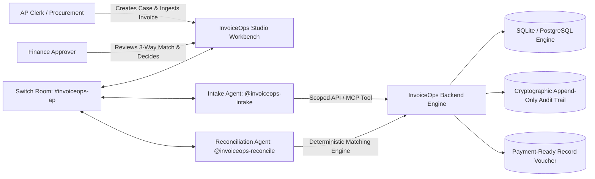

# InvoiceOps — Collaborative Autonomous AP Invoice Exception Resolution

*A human AP Clerk, Procurement Owner, Finance Approver, and specialist AI agents collaborate in real-time to resolve accounts-payable exceptions deterministically and produce auditable payment-ready records.*

---

## Strict Financial Safety & Non-Payment Boundary

> **IMPORTANT**: InvoiceOps reconciles invoices against purchase orders and warehouse receipts, coordinates human exception resolution across multi-agent rooms, and generates a downstream `payment-ready` record after human finance approval. **InvoiceOps never connects to bank APIs, stores banking credentials, or initiates financial transfers.** All included business records are 100% synthetic.

---

## Architecture Overview



### Modular Monolith Architecture
- **Backend**: FastAPI + Pydantic v2 + SQLAlchemy 2.
- **Database**: SQLite (portable production-ready single-file) with PostgreSQL schema compatibility.
- **Matching Engine**: Deterministic Python domain service using pure `Decimal` arithmetic (zero binary float inaccuracies for financial transactions).
- **Frontend Studio**: Apple & Supaste-inspired Dark UI (React 18 + TypeScript + Vite + Tailwind CSS) with Dynamic Island notch, glowing status indicators, high-density data tables, monospaced numeric formatting, and role-based action enforcement.
- **Collaboration Layer**: Switch multi-agent `#invoiceops-ap` room with autonomous reactive agents and Model Context Protocol (MCP) server tools.

---

## Deployment Options

### 1. Docker Compose (Recommended for Production & Judges)
Run the entire production application and the Switch communication bridge with a single command:

```bash
docker compose up --build
```
- **Web Studio & API**: [http://localhost:8000](http://localhost:8000)
- **API Docs**: [http://localhost:8000/docs](http://localhost:8000/docs)
- **Health Check**: [http://localhost:8000/health](http://localhost:8000/health)

---

### 2. Standard Docker Container
Build and run the multi-stage image anywhere (AWS ECS, Google Cloud Run, Azure Container Instances):

```bash
# Build multi-stage image (Vite SPA + FastAPI runtime)
docker build -t invoiceops:latest .

# Run container (respects dynamic PORT)
docker run -p 8000:8000 -e PORT=8000 invoiceops:latest
```

---

### 3. Local One-Click Startup (Windows / macOS / Linux)

#### Windows
Double-click `start.bat` or run:
```powershell
.\start.ps1
```

#### macOS / Linux
```bash
chmod +x start.sh
./start.sh
```

#### Manual Python Execution
```bash
pip install -r requirements.txt
python run_app.py
```
Open **[http://localhost:8000](http://localhost:8000)** in your browser.

---

### 4. Cloud Platform 1-Click Deployments

| Platform | Manifest | Instructions |
| :--- | :--- | :--- |
| **Render** | `render.yaml` | Connect GitHub repo &rarr; New Blueprint &rarr; Deploy automatically. |
| **Railway** | `railway.json` | Connect GitHub repo &rarr; Railway automatically detects Dockerfile and deploys. |
| **Fly.io** | `fly.toml` | Run `fly launch` &rarr; `fly deploy`. |
| **Heroku / Dokku** | `Procfile` | Uses standard `web: uvicorn` worker process with dynamic `$PORT`. |
| **Kubernetes** | `deploy/k8s/deployment.yaml` | `kubectl apply -f deploy/k8s/deployment.yaml` |

---

## Switch Multi-Agent Room & MCP Integration

InvoiceOps natively connects with `sandbox-quantum/switch` across four tiers:

1. **Persistent Collaboration Room**: Threaded multi-turn room `#invoiceops-ap` with avatars and roles.
2. **Autonomous Reactive Agents**: `@invoiceops-intake` and `@invoiceops-reconcile` respond live to user mentions and invoice reconciliation commands.
3. **Native Model Context Protocol (MCP) Server**:
   Exposes 5 production tools under `/api/v1/switch/mcp`:
   - `invoiceops_match`: Trigger deterministic 3-way reconciliation.
   - `invoiceops_inspect`: Inspect line items, discrepancies, and tolerance checks.
   - `invoiceops_attach_evidence`: Resolve blocking exceptions with verified evidence.
   - `invoiceops_approve_payment`: Role-enforced finance sign-off generating payment vouchers.
   - `invoiceops_get_audit`: Query immutable cryptographic audit event trail.
4. **Interactive In-Browser Switch Console**: Click **"Switch Room"** in the top navigation notch or on any case view to open the live console, run the 6-step Judge Demo, or inspect CLI commands.

---

## Synthetic Demo Scenarios

| Case ID | Scenario | Expected Outcome | Workflow Path |
|---|---|---|---|
| `INV-2026-1041` | Valid matching invoice (8 units @ ₹12,000) | `PASS` &rarr; Ready for Finance Approval | Finance Approver approves &rarr; Payment-Ready record generated. |
| `INV-2026-1042` | Quantity mismatch (Billed 10 units vs 8 accepted) | `BLOCKED` (`QTY_EXCEEDS_RECEIVED`) | Routed to Procurement Owner in `#invoiceops-ap`. Procurement attaches verified GRN evidence &rarr; Rerun match passes. |
| `INV-2026-1043` | Duplicate invoice (`NSC 1041-26` normalized) | `BLOCKED` (`DUPLICATE_INVOICE`) | AP Lead review required; blocks payment to prevent duplicate disbursement. |
| `INV-2026-1044` | Price tolerance variance (₹12,500 vs PO ₹12,000) | `BLOCKED` (`PRICE_VARIANCE`) | Exceeds 0.5% / ₹1.00 tolerance; routed to Procurement for commercial review. |

---

## Verification & Automated Test Suite

All 18 core scenarios are verified by automated unit & integration tests:

```bash
python -m pytest backend/tests/test_scenarios.py -v
```

### Verified Test Suite (18/18 Passing)
```text
backend/tests/test_scenarios.py::test_t01_valid_invoice_passes_and_ready_for_approval PASSED [  5%]
backend/tests/test_scenarios.py::test_t02_quantity_mismatch_blocks_approval PASSED [ 11%]
backend/tests/test_scenarios.py::test_t03_price_variance_blocks_and_routes_to_procurement PASSED [ 16%]
backend/tests/test_scenarios.py::test_t04_po_not_found PASSED            [ 22%]
backend/tests/test_scenarios.py::test_t05_grn_missing PASSED             [ 27%]
backend/tests/test_scenarios.py::test_t06_duplicate_vendor_and_normalized_number PASSED [ 33%]
backend/tests/test_scenarios.py::test_t07_duplicate_document_hash PASSED [ 38%]
backend/tests/test_scenarios.py::test_t08_low_confidence_requires_human_review PASSED [ 44%]
backend/tests/test_scenarios.py::test_t09_malformed_currency_rejected PASSED [ 50%]
backend/tests/test_scenarios.py::test_t10_agent_attempt_approval_denied_with_403 PASSED [ 55%]
backend/tests/test_scenarios.py::test_t11_ap_clerk_attempt_approval_denied_with_403 PASSED [ 61%]
backend/tests/test_scenarios.py::test_t12_finance_approval_stale_match_denied_with_409 PASSED [ 66%]
backend/tests/test_scenarios.py::test_t13_approval_repeated_with_same_idempotency_key PASSED [ 72%]
backend/tests/test_scenarios.py::test_t14_invoice_contains_prompt_injection_text PASSED [ 77%]
backend/tests/test_scenarios.py::test_t15_file_exceeds_max_size_returns_413 PASSED [ 83%]
backend/tests/test_scenarios.py::test_t16_resolved_exception_and_rematch_passes PASSED [ 88%]
backend/tests/test_scenarios.py::test_t17_switch_room_message_and_reactive_agent_reply PASSED [ 94%]
backend/tests/test_scenarios.py::test_t18_switch_mcp_server_and_tool_invocation PASSED [100%]

======================= 18 passed in 19.73s =======================
```

---

## Security & Safety Guardrails

1. **Zero Financial Execution**: The API contains no bank transfer, payment rail, or supplier payment initiation endpoints.
2. **Server-Side Role Guardrails**: Agent identities (`invoice_intake_agent`, `invoice_match_agent`) and AP Clerks are forbidden from making approval decisions (HTTP 403 denied). Only human `finance_approver` can approve.
3. **Idempotency Protection**: Mutating financial approval calls enforce unique idempotency keys to prevent double-approvals.
4. **Stale Match Protection**: If invoice, purchase order, or goods receipt records change after a match run, approval is rejected with HTTP 409 Conflict until a fresh match run is executed.
5. **Prompt Injection Resistance**: Documents are treated strictly as untrusted data artifacts. Embedded instructions inside PDF text are never executed.
6. **Append-Only Audit Trail**: Every status transition, document upload, match run, exception evidence attachment, and approval decision is immutably recorded in `audit_events`.

---

## Repository Map

- `backend/` — FastAPI application, SQLAlchemy models, Pydantic schemas, matching engine, and Switch room service.
- `frontend/` — React 18, TypeScript, Vite, and Tailwind CSS operational studio.
- `Dockerfile` — Multi-stage production container build (Vite SPA + Python 3.12 runtime).
- `docker-compose.yml` — Container orchestration for InvoiceOps and Switch Core bridge.
- `deploy/k8s/` — Kubernetes Deployment and Service definitions.
- `render.yaml` / `railway.json` / `fly.toml` / `Procfile` — Multi-cloud zero-config deployment manifests.
- `start.sh` / `start.bat` / `start.ps1` — Cross-platform one-click launch scripts.
- `run_app.py` — Production runner with embedded SPA routing.
# InvoiceOps
