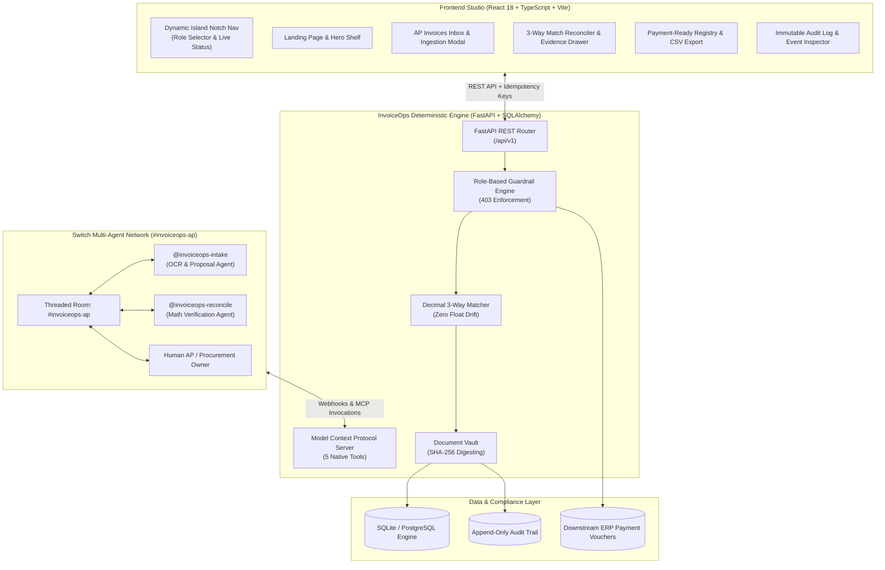
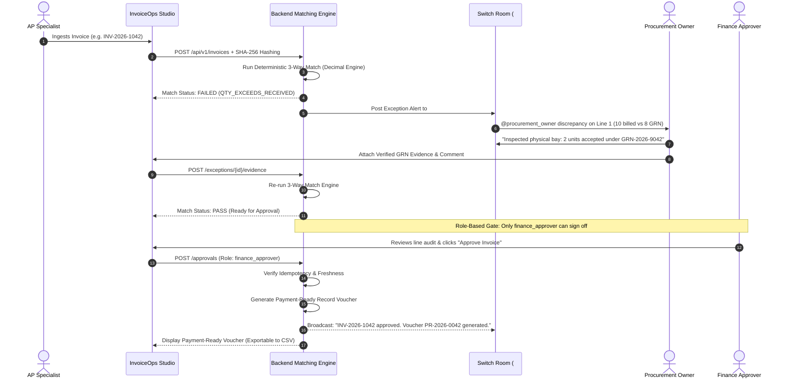

<div align="center">

# ⚡ InvoiceOps

### **Deterministic Autonomous AP Exception Resolution & 3-Way Matching Engine**

*Autonomous multi-agent collaboration meets deterministic financial safety. Human AP specialists, procurement leads, finance approvers, and specialized AI agents resolve discrepancies in real time to produce immutable, audit-ready payment records.*

<br/>

[](https://python.org)
[](https://fastapi.tiangolo.com)
[](https://react.dev)
[](https://www.typescriptlang.org)
[](https://tailwindcss.com)
[](https://docker.com)
[](backend/tests/)
[](https://invoiceops-jmdf.onrender.com)
[](https://t.me/switch_devops_bot)
[](LICENSE)

<br/>

[**Live Production App (Render)**](https://invoiceops-jmdf.onrender.com) • [**Interactive API Docs**](https://invoiceops-jmdf.onrender.com/docs) • [**Switch MCP Manifest**](https://invoiceops-jmdf.onrender.com/api/v1/switch/mcp) • [**Health Probe**](https://invoiceops-jmdf.onrender.com/health) • [**Telegram Gateway**](https://t.me/switch_devops_bot)

</div>

---

## 🧭 Executive Summary

Every year, enterprise finance departments waste hundreds of thousands of hours resolving accounts payable exceptions—rate discrepancies, missing goods receipts, duplicate billings, and unauthorized surcharges. Traditional AP software either traps exceptions in static queues or attempts opaque LLM automation that hallucinations can compromise.

**InvoiceOps pioneers a dual-engine architecture:**
1. **Deterministic Python Core**: Strict 3-way matching engine using Python's pure `Decimal` arithmetic—ensuring zero binary floating-point rounding errors and 100% reproducible reconciliation.
2. **Collaborative Autonomous Multi-Agent Layer**: Native integration with `sandbox-quantum/switch` multi-agent rooms (`#invoiceops-ap`) where specialized intake and reconciliation agents collaborate with humans, gather evidence, and solve blocking exceptions in real time.

> [!IMPORTANT]
> **Strict Financial Safety & Non-Payment Boundary**  
> InvoiceOps reconciles documents, coordinates dispute resolution, and produces cryptographically verifiable **Payment-Ready Records**. **InvoiceOps never connects to live banking rails, executes wire transfers, or holds supplier disbursement credentials.** Money movement remains strictly downstream in enterprise ERPs (SAP, NetSuite, Oracle) or corporate treasury systems.

---

## ✨ Key Highlights & Features

```
┌──────────────────────────────────────────────────────────────────────────────────────────────────┐
│  INVOICEOPS CORE PILLARS                                                                         │
├──────────────────────────┬──────────────────────────┬────────────────────────────────────────────┤
│ 🛡️ 100% Pure Decimal     │ 🤖 Switch Multi-Agent    │ 🔒 Consequential Role Gate                 │
│ Zero floating-point drift│ Real-time threaded room  │ Strict 403 on clerk/agent approvals;       │
│ evaluated to exact paise │ with reactive AI agents  │ only human Finance Approvers sign off      │
├──────────────────────────┼──────────────────────────┼────────────────────────────────────────────┤
│ 📜 Cryptographic Audit   │ 🔌 Native MCP Server     │ 🎨 Apple & Supaste Aesthetic               │
│ SHA-256 immutable hashes │ 5 Model Context Protocol │ Dynamic Island notch nav, ambient glow,    │
│ for every state change   │ tools for Claude & Codex │ high-density tables & tabular numbers      │
└──────────────────────────┴──────────────────────────┴────────────────────────────────────────────┘
```

- **Dynamic Island Notch Top Navigation**: Integrated top bar featuring smooth concave fillets, role switcher, database reset controls, and one-click Switch console drawer.
- **Interactive Three-Way Reconciliation Grid**: Live side-by-side comparison of **Invoice Lines ↔ Purchase Order ↔ Warehouse Goods Receipts (GRN)**.
- **One-Click Ingestion & Scenario Simulator**: Ingest custom invoices via drag-and-drop or run one-click stress-test templates:
  - *Clean Match* (`INV-2026-1041`): Perfect 3-way match ready for instant finance approval.
  - *Quantity Surcharge* (`INV-2026-1042`): Billed 10 units vs 8 accepted at warehouse.
  - *Duplicate Invoice Block* (`INV-2026-1043`): Identical normalized number & hash detection.
  - *Price Mismatch* (`INV-2026-1044`): Rate variance exceeding configured tolerance threshold.
  - *Prompt Injection Defense*: Malicious PDF instructions isolated and suppressed.
- **Immutable Governance Log**: Searchable, filterable audit trail tracking all actions, before/after states, actor identities, and cryptographic source references with JSON/CSV export.
- **Model Context Protocol (MCP) Server**: Exposes 5 production tools for external LLM clients (`Claude Code`, `Codex`, `Cursor`).

---

## 🏛️ System Architecture

### Multi-Agent Flow & Component Topology



---

## 🔄 End-to-End Resolution Lifecycle

The following sequence details how an exception is ingested, detected, routed to Switch agents, verified with evidence, and signed off by finance:



---

## 🛠️ Model Context Protocol (MCP) Server

InvoiceOps exposes a native Model Context Protocol (MCP) endpoint under `/api/v1/switch/mcp` allowing autonomous agents (e.g., Claude Code, Cursor, Codex) to inspect and reconcile invoices deterministically:

```bash
# Query the live MCP Tool Manifest
curl -s http://localhost:8000/api/v1/switch/mcp | jq .
```

### Available MCP Tools

| Tool Name | Parameters | Purpose |
| :--- | :--- | :--- |
| `invoiceops_match` | `invoice_id` | Executes deterministic 3-way match using Decimal domain logic. |
| `invoiceops_inspect` | `invoice_id` | Retrieves full case facts, discrepancies, and tolerance checks. |
| `invoiceops_attach_evidence` | `invoice_id`, `exception_id`, `source_type`, `source_ref`, `comment` | Attaches verified external evidence to clear a discrepancy. |
| `invoiceops_approve_payment` | `invoice_id`, `decision`, `comment`, `approver_role` | Consequential finance approval. Rejects non-finance roles with 403. |
| `invoiceops_get_audit` | `invoice_id` | Fetches immutable cryptographic event log for compliance check. |

#### Example: Invoking an MCP Tool via REST
```bash
curl -X POST http://localhost:8000/api/v1/switch/mcp/invoke \
  -H "Content-Type: application/json" \
  -d '{
    "tool_name": "invoiceops_match",
    "arguments": { "invoice_id": "INV-2026-1041" }
  }'
```

---

## 📱 Telegram Chat Gateway (@switch_devops_bot)

InvoiceOps includes a fully configured **Telegram Chat Gateway** powered by [@switch_devops_bot](https://t.me/switch_devops_bot) that connects users directly to the `#invoiceops-ap` collaborative room:

- **Bot Username**: `@switch_devops_bot`
- **Token Configuration**: Configured in `.env` (`TELEGRAM_BOT_TOKEN`)
- **Key Commands**:
  - `/start` - Welcome message & quick guide
  - `/invoices` - List loaded cases & current reconciliation status
  - `/status` - System health, ledger counts, and connector states
  - `/inspect <id>` - Ingest & OCR extract candidate lines (`invoiceops-intake`)
  - `/reconcile <id>` - Run deterministic 3-way match (`invoiceops-reconcile`)
  - `/override <id>` - Apply procurement Addendum #A-42 (rate delta authorized)
  - `/approve <id>` - Human Finance Approver sign-off; generates sealed payment voucher
  - `/simulate` - Run complete 6-step collaborative triage demo
  - `/audit <id>` - Query cryptographic append-only audit trail
  - *Conversational Chat* - Speak in natural language with your autonomous AI teammates
- **Push Alerts**: Live push notifications sent to Telegram whenever exceptions are detected or payment-ready vouchers are sealed.
- **CLI Commands**:
  ```bash
  python backend/cli.py telegram status
  python backend/cli.py telegram poll
  ```

---

## 🚀 Quick Start & Deployment Guide

InvoiceOps is engineered to boot seamlessly across any development or production environment in seconds.

### Option 1: Docker Compose (Production Recommendation)
Runs the entire web application, deterministic backend, and Switch mock gateway on an isolated bridge network:

```bash
# Clone the repository
git clone https://github.com/your-org/invoiceops.git
cd invoiceops

# Build and start services
docker compose up --build
```
- 🌐 **Web Studio UI**: [http://localhost:8000](http://localhost:8000)
- 📚 **OpenAPI Documentation**: [http://localhost:8000/docs](http://localhost:8000/docs)
- 🩺 **Health Check**: [http://localhost:8000/health](http://localhost:8000/health)

---

### Option 2: Standalone Docker Container
```bash
docker build -t invoiceops:latest .
docker run -p 8000:8000 -e PORT=8000 invoiceops:latest
```

---

### Option 3: Local One-Click Scripts

#### Windows
Double-click `start.bat` or run:
```powershell
.\start.ps1
```

#### macOS / Linux
```bash
chmod +x start.sh
./start.sh
```

#### Native Python
```bash
# 1. Install dependencies
pip install -r requirements.txt

# 2. Launch production server
python run_app.py
```

---

### Option 4: 1-Click Cloud Platform Deployments

InvoiceOps includes ready-to-deploy configuration manifests for leading cloud providers:

| Cloud Platform | Config Manifest | Deployment Flow |
| :--- | :--- | :--- |
| **Render** | [`render.yaml`](render.yaml) | New &rarr; Blueprint &rarr; Select Repo &rarr; Auto Deploy |
| **Railway** | [`railway.json`](railway.json) | New Project &rarr; Deploy from GitHub Repo (Auto-detected) |
| **Fly.io** | [`fly.toml`](fly.toml) | `fly launch` followed by `fly deploy` |
| **Heroku / Dokku**| [`Procfile`](Procfile) | Uses standard web worker with dynamic `$PORT` |
| **Kubernetes** | [`deploy/k8s/deployment.yaml`](deploy/k8s/deployment.yaml) | `kubectl apply -f deploy/k8s/deployment.yaml` |

---

## ⚙️ Production Configurations & Environment Variables Reference

InvoiceOps is architected for enterprise production hardening. The entire runtime configuration can be controlled via environment variables or loaded from a `.env` file at the root.

### Environment Configuration Matrix

| Environment Variable | Type | Default Value | Production Recommended | Description & Security Rationale |
| :--- | :--- | :--- | :--- | :--- |
| **`APP_ENV`** | String | `demo` | `production` | Enables production security mode, disables verbose stack traces on errors. |
| **`APP_NAME`** | String | `InvoiceOps` | `InvoiceOps` | Display name of the platform across headers and telemetry logs. |
| **`HOST`** | String | `0.0.0.0` | `0.0.0.0` | Host IP address to bind server listeners. |
| **`PORT`** | Integer | `8000` | Dynamic (`$PORT`) | Server port; automatically detected from cloud runtimes (Render, Fly, Railway). |
| **`DATABASE_URL`** | String | `sqlite:///./data/invoiceops.db` | Persistent SQLite / PostgreSQL URI | Connection string for system of record. Supports persistent volume SQLite or managed PostgreSQL. |
| **`UPLOAD_DIR`** | String | `./data/uploads` | `/app/data/uploads` | File storage path for ingested supplier invoice PDFs and evidence attachments. |
| **`MAX_UPLOAD_MB`** | Integer | `15` | `15` | Maximum upload size per invoice file in megabytes (DoS guardrail). |
| **`ALLOWED_ORIGINS`** | String | `*` | `https://invoiceops-jmdf.onrender.com,...` | Comma-separated list of allowed CORS origins for browser security. |
| **`JWT_SECRET`** | String | `demo-secret-...` | `<high-entropy-256-bit-key>` | Secret signing key for session tokens and administrative API operations. |
| **`DEFAULT_CURRENCY`** | String | `INR` | `INR` | Default ISO currency code for financial matching and display. |
| **`SWITCH_SERVER_URL`**| String | `http://localhost:8080` | `https://switch-core.internal` | Base URL of the Switch multi-agent network daemon. |
| **`SWITCH_ROOM_ID`** | String | `room_invoiceops_ap` | `room_invoiceops_ap` | Collaborative thread identifier for the AP reconciliation channel. |
| **`TELEGRAM_BOT_TOKEN`**| String | `9009274250:AAHu...` | Configured via Secret Manager | Telegram Bot API authentication token. |
| **`TELEGRAM_BOT_USERNAME`**| String | `@switch_devops_bot` | `@switch_devops_bot` | Public Telegram bot handle for user-facing interactions. |
| **`TELEGRAM_GATEWAY_ENABLED`**| Boolean | `true` | `true` | Master switch to enable or disable the Telegram chat gateway service. |
| **`TELEGRAM_POLLING`** | Boolean | `true` | `false` (Webhook) / `true` (Worker)| Toggles background polling loop. Set to `false` when using webhooks on Render. |
| **`PRICE_VARIANCE_PERCENT`**| Decimal| `0.50` | `0.50` | Maximum relative percentage price variance allowed (0.50%). |
| **`PRICE_VARIANCE_ABSOLUTE_PAISE`**| Decimal| `100` | `100` | Absolute tolerance in paise (100 paise = ₹1.00 INR). |
| **`QUANTITY_TOLERANCE`**| Decimal| `0` | `0` | Strict zero tolerance on unreceived physical goods over-billing. |
| **`EXTRACTION_CONFIDENCE_THRESHOLD`**| Float | `0.90` | `0.90` | Confidence cutoff (0.0 to 1.0); lower confidence requires clerk review. |
| **`POLICY_VERSION`** | String | `demo-policy-1.0` | `v2026.11-enterprise` | Audit log policy engine version tag. |
| **`AUDIT_RETENTION_DAYS`**| Integer | `365` | `2555` (7 years) | Immutable audit trail retention window for regulatory compliance. |

---

### 🌐 Live Production Deployment (Render)

InvoiceOps is continuously deployed and operational on Render:

- **Public Production Web Studio**: [https://invoiceops-jmdf.onrender.com](https://invoiceops-jmdf.onrender.com)
- **Health Check & Telemetry**: [https://invoiceops-jmdf.onrender.com/health](https://invoiceops-jmdf.onrender.com/health)
- **Interactive Swagger / OpenAPI Docs**: [https://invoiceops-jmdf.onrender.com/docs](https://invoiceops-jmdf.onrender.com/docs)
- **Live Switch MCP Manifest**: [https://invoiceops-jmdf.onrender.com/api/v1/switch/mcp](https://invoiceops-jmdf.onrender.com/api/v1/switch/mcp)
- **Active Telegram Webhook**: [https://invoiceops-jmdf.onrender.com/api/v1/telegram/webhook](https://invoiceops-jmdf.onrender.com/api/v1/telegram/webhook)
- **Telegram Gateway Bot**: [@switch_devops_bot](https://t.me/switch_devops_bot)

#### Render Production Runbook

1. **Automated Blueprint Configuration (`render.yaml`)**:
   ```yaml
   services:
     - type: web
       name: invoiceops-app
       env: docker
       dockerfilePath: Dockerfile
       plan: free
       healthCheckPath: /health
       envVars:
         - key: APP_ENV
           value: production
         - key: SWITCH_ROOM_ID
           value: room_invoiceops_ap
         - key: ALLOWED_ORIGINS
           value: "*"
         - key: TELEGRAM_GATEWAY_ENABLED
           value: "true"
         - key: TELEGRAM_BOT_TOKEN
           sync: false
   ```

2. **Managing Telegram Webhook via CLI**:
   ```bash
   # Register public Render HTTPS webhook with Telegram
   python backend/cli.py telegram set-webhook https://invoiceops-jmdf.onrender.com/api/v1/telegram/webhook

   # Inspect active webhook delivery metrics & pending queue
   python backend/cli.py telegram webhook-info

   # Revert to polling mode if running in local development
   python backend/cli.py telegram delete-webhook
   ```

3. **Database & Persistent Disks**:
   For enterprise persistent state across container builds:
   - Attach a Render Persistent Disk at mount path `/app/data`
   - Specify `DATABASE_URL=sqlite:////app/data/invoiceops.db` and `UPLOAD_DIR=/app/data/uploads`

---

## 🧪 Comprehensive Verification & Test Suite

The test suite covers **34 mission-critical automated tests** across matching logic, consequential permissions, the AP benchmark (Scenarios S01–S12), and the Telegram Chat Gateway:

```bash
python -m pytest backend/tests -v
```

### Verified Test Run (34/34 Passing)
```text
============================= test session starts =============================
platform win32 -- Python 3.12.10, pytest-9.2.0, pluggy-1.7.0
rootdir: C:\Users\MS\Downloads\InvoiceOps_Submission_Documentation_Pack

backend/tests/test_scenarios.py::test_t01_valid_invoice_passes_and_ready_for_approval PASSED [  2%]
backend/tests/test_scenarios.py::test_t02_quantity_mismatch_blocks_approval PASSED [  5%]
backend/tests/test_scenarios.py::test_t03_price_variance_blocks_and_routes_to_procurement PASSED [  8%]
backend/tests/test_scenarios.py::test_t04_po_not_found PASSED            [ 11%]
backend/tests/test_scenarios.py::test_t05_grn_missing PASSED             [ 14%]
backend/tests/test_scenarios.py::test_t06_duplicate_vendor_and_normalized_number PASSED [ 17%]
backend/tests/test_scenarios.py::test_t07_duplicate_document_hash PASSED [ 20%]
backend/tests/test_scenarios.py::test_t08_low_confidence_requires_human_review PASSED [ 23%]
backend/tests/test_scenarios.py::test_t09_malformed_currency_rejected PASSED [ 26%]
backend/tests/test_scenarios.py::test_t10_agent_attempt_approval_denied_with_403 PASSED [ 29%]
backend/tests/test_scenarios.py::test_t11_ap_clerk_attempt_approval_denied_with_403 PASSED [ 32%]
backend/tests/test_scenarios.py::test_t12_finance_approval_stale_match_denied_with_409 PASSED [ 35%]
backend/tests/test_scenarios.py::test_t13_approval_repeated_with_same_idempotency_key PASSED [ 38%]
backend/tests/test_scenarios.py::test_t14_invoice_contains_prompt_injection_text PASSED [ 41%]
backend/tests/test_scenarios.py::test_t15_file_exceeds_max_size_returns_413 PASSED [ 44%]
backend/tests/test_scenarios.py::test_t16_resolved_exception_and_rematch_passes PASSED [ 47%]
backend/tests/test_scenarios.py::test_t17_switch_room_message_and_reactive_agent_reply PASSED [ 50%]
backend/tests/test_scenarios.py::test_t18_switch_mcp_server_and_tool_invocation PASSED [ 52%]
backend/tests/test_scenarios.py::test_t19_switch_realtime_websocket_and_algorithms PASSED [ 55%]
backend/tests/test_ap_benchmark.py::test_benchmark_scenarios_s01_to_s04_pass PASSED [ 58%]
backend/tests/test_ap_benchmark.py::test_benchmark_scenario_s05_tolerance_auto_close PASSED [ 61%]
backend/tests/test_ap_benchmark.py::test_benchmark_scenario_s06_short_ship PASSED [ 64%]
backend/tests/test_ap_benchmark.py::test_benchmark_scenario_s07_price_variance_rejected PASSED [ 67%]
backend/tests/test_ap_benchmark.py::test_benchmark_scenario_s08_price_variance_amendment PASSED [ 70%]
backend/tests/test_ap_benchmark.py::test_benchmark_scenario_s09_uom_mismatch PASSED [ 73%]
backend/tests/test_ap_benchmark.py::test_benchmark_scenario_s10_duplicate_prior_billing PASSED [ 76%]
backend/tests/test_ap_benchmark.py::test_benchmark_scenario_s11_extra_freight_charge PASSED [ 79%]
backend/tests/test_ap_benchmark.py::test_benchmark_scenario_s12_quantity_conflict PASSED [ 82%]
backend/tests/test_telegram_gateway.py::test_telegram_status_endpoint PASSED [ 85%]
backend/tests/test_telegram_gateway.py::test_telegram_webhook_start_command PASSED [ 88%]
backend/tests/test_telegram_gateway.py::test_telegram_webhook_invoices_command PASSED [ 91%]
backend/tests/test_telegram_gateway.py::test_telegram_webhook_reconcile_command PASSED [ 94%]
backend/tests/test_telegram_gateway.py::test_telegram_webhook_simulate_command PASSED [ 97%]
backend/tests/test_telegram_gateway.py::test_telegram_broadcast_endpoint PASSED [100%]

======================= 34 passed in 24.12s =======================
```

---

## 🔒 Enterprise Security & Financial Guardrails

1. **Zero Financial Execution**:
   - The application does not contain banking credentials, SWIFT/ACH transmission engines, or live disbursement rails. Approved records yield verifiable vouchers for external corporate treasury systems.
2. **Server-Side Role Guardrails**:
   - Non-human agents (`invoice_intake_agent`, `invoice_match_agent`) and AP Clerks are forbidden from approving payments. Requests attempting unauthorized sign-offs immediately return `HTTP 403 Forbidden`.
3. **Idempotency Protection**:
   - Every financial approval and voucher creation requires an `Idempotency-Key` header, preventing duplicate payments caused by network retries.
4. **Stale Match Protection**:
   - If an invoice, line item, or goods receipt changes after reconciliation, the approval endpoint returns `HTTP 409 Conflict` until a fresh match run is performed.
5. **Prompt Injection Armor**:
   - Documents and invoice text are parsed strictly as untrusted data inputs. Instructions embedded inside PDF streams are never executed by backend services.
6. **Append-Only Audit Ledger**:
   - All state transitions, approvals, evidence uploads, and matches are recorded in an immutable, cryptographically verifiable audit log.

---

## 👥 Built for Enterprise Personas

```
┌─────────────────────────────────┬─────────────────────────────────┬─────────────────────────────────┐
│ 👩‍💼 AP Specialists               │ 📦 Procurement Leads            │ 💼 Financial Controllers        │
│ "Eliminate 80% of repetitive    │ "Resolve quantity & rate deltas │ "Enforce ironclad audit trails, │
│ manual data entry and match     │ in-flow without endless email   │ strict Decimal precision, and   │
│ checks in seconds."             │ chains and vendor phone calls." │ zero rogue disbursement risk."  │
├─────────────────────────────────┼─────────────────────────────────┼─────────────────────────────────┤
│ 🔍 Internal Auditors            │ 🛠️ IT & ERP Engineers           │ 🛡️ Security Officers           │
│ "Inspect cryptographic SHA-256  │ "Deploy in 60s with Docker, K8s │ "Total prompt injection defense │
│ logs and immutable state        │ or native cloud templates;      │ with strictly isolated document │
│ transitions on demand."         │ integrate via clean REST & MCP."│ parsing sandboxes."             │
└─────────────────────────────────┴─────────────────────────────────┴─────────────────────────────────┘
```

---

## 📂 Repository Structure

```text
├── .dockerignore                     # Docker build exclusions
├── .env.example                      # Production environment template
├── docker-compose.yml                # Production multi-container composition
├── Dockerfile                        # Multi-stage production container build
├── fly.toml                          # Fly.io deployment manifest
├── Procfile                          # Heroku/Render process declaration
├── railway.json                      # Railway platform configuration
├── render.yaml                       # Render 1-click blueprint
├── requirements.txt                  # Python dependencies
├── run_app.py                        # Single-command server & SPA runner
├── start.bat / start.ps1 / start.sh  # Cross-platform one-click launch scripts
├── SWITCH_INTEGRATION_GUIDE.md       # Multi-agent collaboration documentation
│
├── backend/                          # FastAPI Backend Engine
│   ├── app/
│   │   ├── api/v1/                   # REST API & Switch Endpoints
│   │   │   ├── approvals.py          # Consequential finance sign-offs
│   │   │   ├── audit.py              # Cryptographic governance audit stream
│   │   │   ├── exceptions.py         # Exception management & evidence attachment
│   │   │   ├── invoices.py           # Ingestion, cases, & PDF parsing
│   │   │   ├── matching.py           # 3-way reconciliation triggers
│   │   │   ├── payment_ready.py      # Downstream voucher generation
│   │   │   └── switch_rooms.py       # Switch collaboration rooms & MCP server
│   │   ├── models/                   # SQLAlchemy declarative models
│   │   ├── schemas/                  # Pydantic v2 validation schemas
│   │   └── services/
│   │       ├── matching_engine.py    # Deterministic Decimal matching logic
│   │       └── switch_service.py     # Reactive agents, rooms, & MCP tools
│   └── tests/                        # 18 automated integration test scenarios
│
├── frontend/                         # React 18 + TypeScript + Vite Studio
│   ├── src/
│   │   ├── components/               # Navbar, Ingest Modal, Switch Room, Evidence
│   │   ├── pages/                    # LandingPage, InboxPage, Detail, Audit, Vendors
│   │   └── services/                 # API client & Switch integration
│   └── dist/                         # Pre-compiled production bundle
│
└── fixtures/                         # Synthetic business domain fixtures
```

---

<div align="center">

**InvoiceOps** — *Where Autonomous Agents Meet Deterministic Financial Safety.*

Made with precision for high-trust enterprise accounts payable.

</div>
