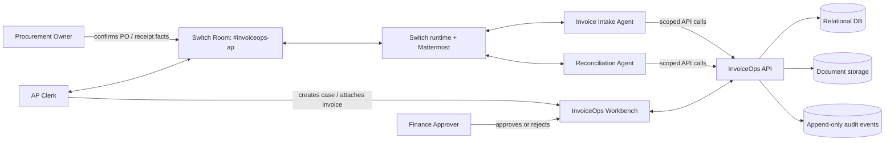
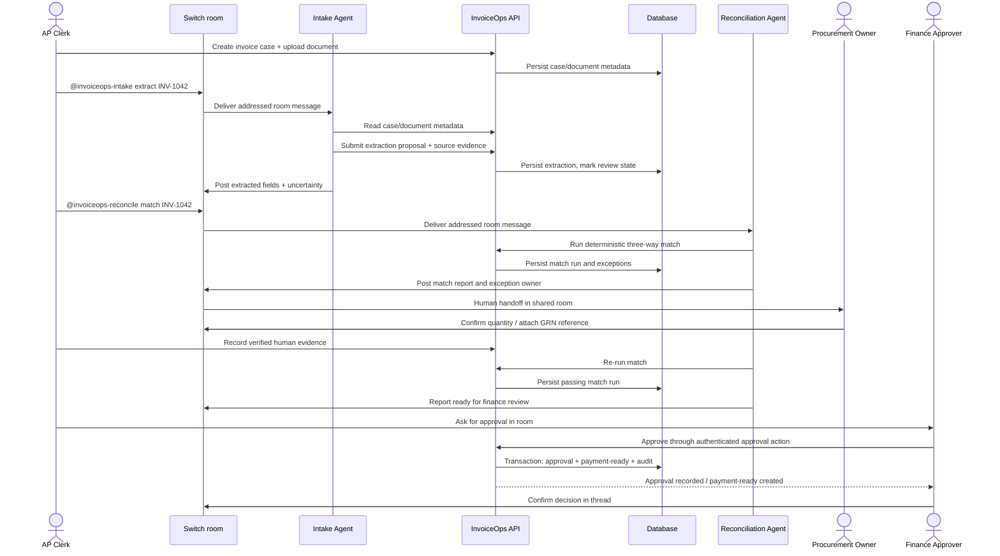
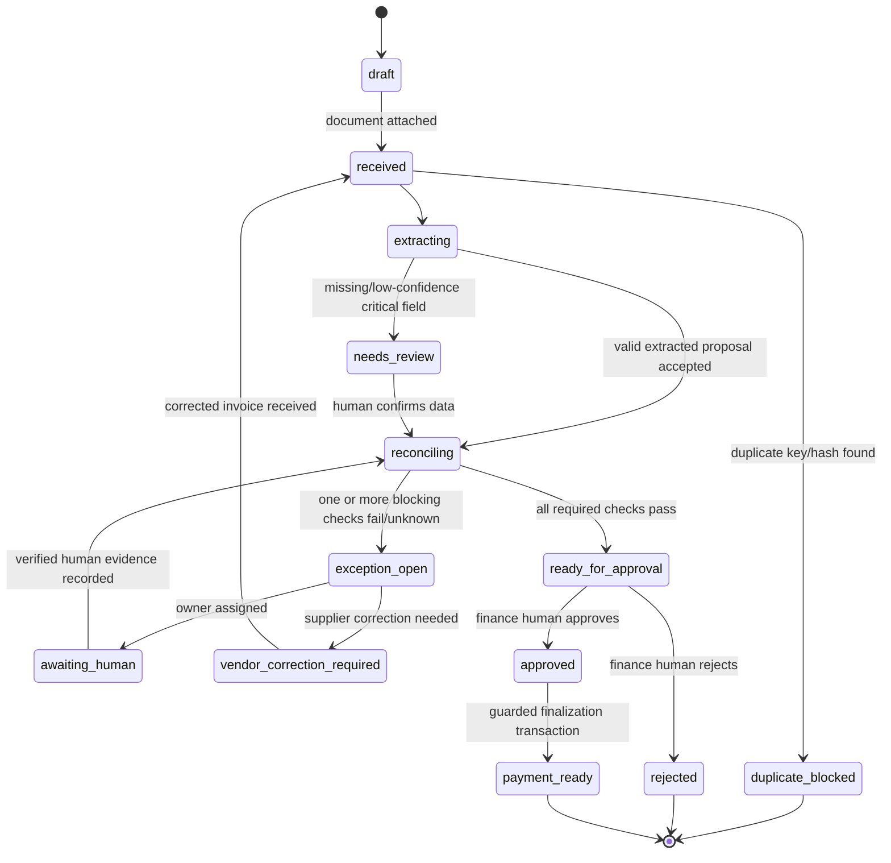

# 03 — System Design

## 1. Design goals

- Make team collaboration visible in Switch rather than replacing the chat app.
- Separate probabilistic language-model work (document field extraction and narrative summaries) from deterministic financial decisions (matching and approvals).
- Make every consequential state change traceable.
- Keep the demo deployable on a laptop.

## 2. Context diagram

## 3. Container architecture

| Container | Responsibility | Trust boundary |
|---|---|---|
| React Workbench | Case queue, invoice detail, evidence, approval controls | Human-authenticated browser |
| FastAPI | Validation, auth, business services and API | Application service boundary |
| Domain services | Extraction orchestration, matching, exception rules, approval state machine | No LLM authority for financial decisions |
| Database | Vendors, POs, GRNs, invoices, match runs, exceptions, approvals, audit events | Persistent data boundary |
| File storage | Original invoice and supporting evidence | Untrusted file boundary |
| Switch Console/Room | Human/agent collaboration and shared context | External collaboration runtime; agents inherit owner access as described by Switch docs |
| Agent provider runtime | LLM-based extraction proposals and narrative/coordination | Untrusted model output boundary |

## 4. Runtime workflow

Switch transport is intentionally shown as a black box here. InvoiceOps agents do not implement a fake Switch webhook. Agents are connected through Switch Console or a documented custom agent client.

## 5. Service decomposition

For hackathon delivery use a modular monolith, not microservices:

- `invoice_service`: create/read/update invoice case metadata.
- `document_service`: validate upload, hash, store and retrieve safe document text.
- `extraction_service`: provider-assisted proposal + deterministic schema validation.
- `matching_service`: three-way match and duplicate checks.
- `exception_service`: create/assign/propose resolution/record human evidence.
- `approval_service`: finance-role check and atomic state transition.
- `audit_service`: append audit records.
- `switch_tool_adapter`: CLI commands/API methods called by Switch agents; not a replacement for Switch.

## 6. State machine

State rules:

- `duplicate_blocked` is a terminal hold for the current case unless a human with AP lead role explicitly marks the duplicate finding as false positive with evidence.
- A `pass` result is not sufficient if another mandatory check is `unknown`.
- Only a `finance_approver` may approve.
- No `agent` actor may call approve/reject/finalize successfully.
- `payment_ready` means ready for a separate payment process, not paid.

## 7. Three-way matching algorithm

For each invoice line:

1. Resolve vendor and PO reference; if unresolved, create `PO_NOT_FOUND` or `VENDOR_MISMATCH`.
2. Match line to PO line by SKU where available; fallback to a manually confirmed mapping. Do not fuzzy-match without a human confirmation.
3. Read PO quantity and accepted GRN quantity (sum accepted receipt quantities for the PO line).
4. Compare invoice quantity to accepted receipt quantity.
5. Compare invoice unit price to PO unit price under the configured tolerance policy.
6. Recompute invoice line net amount and document total using Decimal; compare with declared amounts using currency precision.
7. Check duplicate key `(vendor_id, normalized_invoice_number)` and exact document hash.
8. Return per-check `pass`, `fail` or `unknown`, source references and blocking reasons.

Overall result:

- `PASS`: every mandatory check passes and no duplicate exists.
- `BLOCKED`: at least one mandatory check fails or duplicate is confirmed.
- `NEEDS_HUMAN`: at least one mandatory check is unknown or requires business confirmation.

The model may explain a result but cannot override it.

## 8. Exception taxonomy

| Code | Meaning | Default owner | Blocks approval |
|---|---|---|---|
| `DUPLICATE_INVOICE` | Existing invoice with same vendor+number or same content hash | AP Lead | Yes |
| `PO_NOT_FOUND` | PO reference absent/unresolved | Procurement | Yes |
| `VENDOR_MISMATCH` | Vendor identity differs between invoice and PO | AP Clerk + Procurement | Yes |
| `GRN_MISSING` | No accepted receipt record exists | Warehouse/Procurement | Yes |
| `QTY_EXCEEDS_RECEIVED` | Invoice quantity exceeds accepted receipt quantity | Procurement | Yes |
| `PRICE_VARIANCE` | Invoice unit price outside approved tolerance | Procurement | Yes |
| `LINE_TOTAL_MISMATCH` | Quantity × unit price does not equal line total | AP Clerk | Yes |
| `INVOICE_TOTAL_MISMATCH` | Declared total differs from recomputed components | AP Clerk | Yes |
| `LOW_EXTRACTION_CONFIDENCE` | Critical field cannot be trusted | AP Clerk | Yes |
| `CURRENCY_MISMATCH` | Currency differs across source records | Finance | Yes |

## 9. Data consistency and transactions

Approval/finalization must be a single database transaction:

1. Lock/read invoice state.
2. Confirm caller identity and role.
3. Confirm latest match run is `PASS` and references current invoice/PO/GRN versions.
4. Confirm no open blocking exception.
5. Insert approval record and audit event.
6. If finalization is requested, insert payment-ready row and audit event.
7. Commit once.

Use optimistic version columns on invoices/match inputs to prevent a stale match result from being approved after a PO or GRN changed. If any relevant record changes, require a new match run.

## 10. Failure handling

- Agent unavailable: case remains in queue; AP Clerk can run the same deterministic match from UI/CLI.
- OCR/extraction fails: keep original file, create a retryable extraction error, route to manual entry.
- DB unavailable: fail closed; do not post a success message.
- Switch room unavailable: business records remain safe; show communication unavailable and resume collaboration after reconnect. The hackathon demo must demonstrate Switch as the intended coordination plane even though API persistence is independent.
- Conflicting human confirmations: keep `awaiting_human`, record both claims and escalate to AP Lead.

## 11. Switch-specific design

- One main room: `#invoiceops-ap`.
- Two distinct agent roles: `invoiceops-intake` and `invoiceops-reconcile`.
- Human roles: AP Clerk, Procurement Owner, Finance Approver.
- Room instructions define scope, who owns each exception, thread conventions, response brevity, fail-closed behavior and no-payments boundary.
- Use mentions/targeted handoffs; the agent receiving the mention should own the next step and report evidence in the same thread.
- Attach the runbook and policy reference as room materials where supported.
- Switch's documented operation catalog has room/messaging/resource/role operations; no separate first-class task protocol is assumed. Handoff is a message/mention-based workflow.

## 12. What judges should see

The Switch room should visibly contain:
- Human case initiation.
- Intake agent extraction response with source evidence.
- Reconciliation agent's match result and exact exception.
- Human Procurement response or confirmation.
- Reconciliation rerun with changed result.
- Human Finance approval.
- Agent summary of final payment-ready record and audit reference.

A separate UI card or dashboard metric cannot substitute for these collaboration steps.
